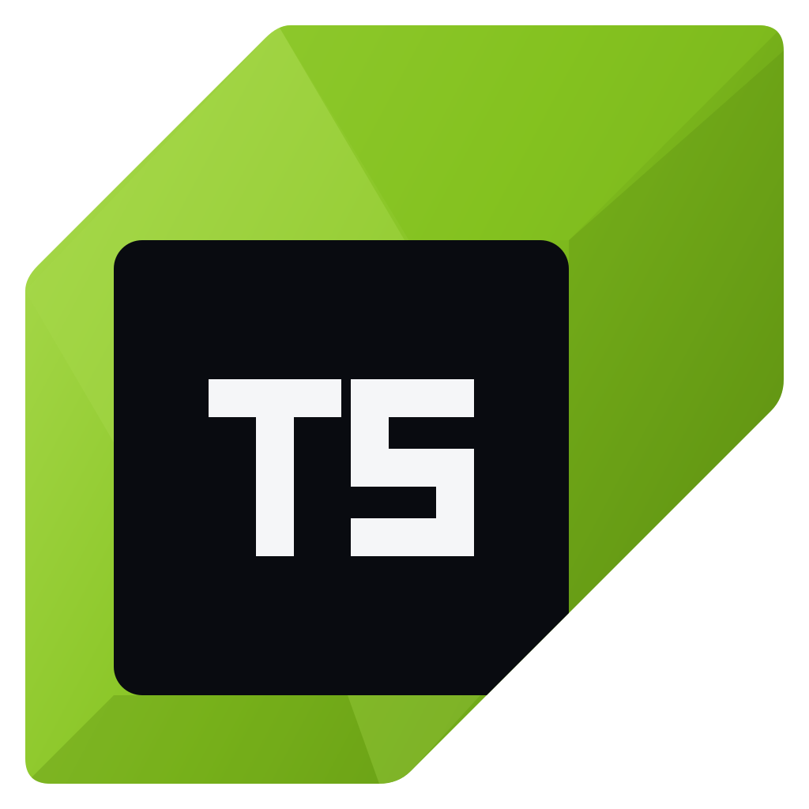

# Threadscan



Part of the Thread ecosystem. A standalone AI vulnerability scanner for private code. It is modelled on the shape of
Anthropic's public [OSS Scanner](https://github.com/anthropics/oss-scanner) (a target
config of `project.yaml` + `Dockerfile` + `threat_model.md`; build online, analyse
offline; report with a reproducer and a proposed patch), but it runs on your own machine,
against repos that cannot be enrolled in a public service. No code is shared with it.

What it does:

1. Builds the target with `docker build` (network on: all dependencies are fetched here).
2. Splits the target into components and runs one headless Claude agent per component,
   inside the built image, with the Internet cut except for an Anthropic-API-only gateway.
   Agents get the threat model, the known-issues list and optional seed output from
   CodeQL (SARIF), gitleaks and OSV.
3. **Verification gate:** re-runs every candidate's reproducer itself, in fresh containers
   with no network at all, before and after the proposed patch. Only candidates that
   demonstrably reproduce, and stop reproducing with the patch, become findings. The rest
   are dropped and counted, never reported.
4. Writes per-finding JSON, a Markdown report and a run summary, and serves a local
   dashboard with live progress and the findings list.

Diff mode (only components touched since a git ref) is the default; a full scan is opt-in.

## Status of v1

| Part | State |
|---|---|
| Config parsing, component splitting, diff selection, seeds, prompts, gate logic, report, dashboard | Implemented, unit-tested (`pytest`), dry run against `targets/demo` works end to end |
| Docker build, scan network, gateway, agent runs, verification containers | Implemented, **not yet exercised**: Docker and an API key were not available on the machine v1 was built on |
| Subscription mode (`auth: subscription`) | Implemented and unit-tested, **not yet run against the real API**: whether Claude Code sends its OAuth token through `ANTHROPIC_BASE_URL` is unconfirmed |

Expect the first real run to need small fixes in those last two rows. Follow
[LAB-TEST.md](LAB-TEST.md): `threadscan doctor --live` first (it exercises the gateway, the
token, Claude Code and the verification driver for a few cents), then the small demo target,
then one component of a real target.

## Setup

Requirements: Python 3.10+, git, Docker (Docker Desktop on Windows/macOS), and either a
Claude subscription or an Anthropic API key. The host needs PyYAML only; the Claude Agent
SDK is installed inside the scan image, not on your machine.

```bash
python -m venv .venv
.venv/Scripts/pip install -e ".[dev]"     # Linux/macOS: .venv/bin/pip
```

### Credentials: subscription or API key

`scan.auth` in `project.yaml` (or `--auth`) picks one. Either credential comes from the
environment of the shell you scan from; never write it into a file in this repo.

**`subscription`** (your own Pro/Max plan, what `targets/demo` uses). Create a one-year
Claude Code token and set it for the session:

```bash
claude setup-token
```

```powershell
$env:CLAUDE_CODE_OAUTH_TOKEN = "<token>"  # PowerShell, this session only
```

- Usage is not billed per token; it counts against the plan's 5-hour and weekly limits,
  which are shared with claude.ai and your own Claude Code use. Anthropic does not publish
  exact numbers.
- Safeguards in this mode: one agent at a time unless `scan.concurrency` is set; a `--full`
  scan is refused without `--max-components`, `--only` or `--allow-full`; when the API
  answers 429 (the usage limit), no further components start, and the report lists them
  with a ready `--only …` command to resume after the reset.
- Costs in the report are API-price equivalents, labelled "not billed".
- **Personal use only.** Anthropic does not allow offering claude.ai login or subscription
  limits to other users of a product built on the Agent SDK without approval. If Threadscan
  is ever shipped to others, they must use an API key.

**`api_key`** (Claude Console, pay per use; better for full scans):

```powershell
$env:ANTHROPIC_API_KEY = "<key>"          # PowerShell, this session only
```

```bash
export ANTHROPIC_API_KEY="<key>"          # bash
```

## Usage

```bash
threadscan doctor targets/demo                            # is this machine ready? (free)
threadscan doctor targets/demo --live                     # end-to-end smoke test (a few cents)
threadscan scan targets/demo --full --max-components 1    # cheap real run on the demo app
threadscan validate targets/myapp                         # check the config
threadscan components targets/myapp                       # what diff mode would scan
threadscan components targets/myapp --full                # all components
threadscan scan targets/myapp --dry-run --max-components 1   # plan only: no build, no API calls
threadscan scan targets/myapp --max-components 1 --dashboard # real scan of one component, with dashboard
threadscan scan targets/myapp --since origin/main         # diff mode against another base
threadscan scan targets/myapp --full --concurrency 2      # full scan (expensive)
threadscan scan targets/myapp --seed codeql=codeql.sarif --seed osv=osv.json
threadscan dashboard                                      # http://127.0.0.1:8765/
threadscan export runs/<run-id> --format all              # SARIF, CSV, JSON, self-contained HTML
threadscan recheck targets/myapp                          # re-verify open issues on the current code (no API usage)
```

Useful flags: `--only NAME` (repeatable) scans named components; `--repo PATH|URL`
overrides `project.yaml`; `--runs-dir` changes where output goes (default `runs/`, which
is gitignored).

### Doctor

`threadscan doctor [target]` checks Python, git, Docker (Linux engine, memory, BuildKit),
free disk, the credential for the auth mode (set or not, and whether it looks like the right
kind; the value is never printed), the target config and repo, and that Docker can create an
internal network. `--live` also starts the gateway, probes it from the internal network,
checks that the internal network cannot reach the internet, builds a small scan image with
the real overlay, runs one tiny Claude Code agent through the gateway (Haiku by default,
`--model` to change), and runs the verification driver offline. Results are printed and
saved to `runs/doctor-<time>/doctor.json`.

### Tidying up

`threadscan prune [--keep 10] [--project NAME] [--yes]` lists, and with `--yes` deletes, old
run directories: per target it keeps the newest N finished runs and always the newest
completed scan (the next scan's comparison baseline); running scans, `triage.json` and
`.watch/` are never touched, and nothing outside the runs directory is ever removed.

### Watching for new commits

`threadscan watch <target> [--interval 15m] [--recheck] [--initial] [--once]` checks the
repository on an interval (fetching a remote one) and, when HEAD moves, runs a diff scan
since the last scanned commit, one scan at a time. The first start only records a baseline
(`--initial` scans right away). A failed scan keeps the baseline so the same range is tried
again; when the subscription's usage limit stops a scan it pauses for an hour and keeps the
baseline, so skipped components are covered later. `--recheck` re-runs the reproducers of
open issues after each scan. `--once` checks a single time, for a scheduler. State is in
`runs/.watch/<name>.json`.

### Seeds

`threadscan seeds <target> [--tool codeql|gitleaks|osv] [--github owner/repo] [--ref REF]`
collects seed input into `targets/<name>/seeds/`: the newest CodeQL analysis per language from
GitHub code scanning (read-only `gh api`; the repository comes from the checkout's `origin`
remote), gitleaks with `--redact`, and osv-scanner, each only when available. It prints the
`seeds:` lines to add to `project.yaml` when they are missing.

### Re-checking fixes

`threadscan recheck <target> [--run ID] [--all]` rebuilds the target image from the current
code and re-runs the reproducer of every open issue from the latest finished run, offline and
without agents, so it uses no API or subscription usage. Exit 0 without the proof line marks
the issue Resolved in triage, with the evidence and commit in its Activity; a reproducer that
still works re-opens an issue someone had marked Resolved; one that cannot run changes
nothing and is reported. Risk-accepted and false-positive issues are skipped unless `--all`.
Results go to `runs/rechecks/` and the dashboard's Reports view.

### Reports and exports

Every finished run writes `findings.sarif`, `report.html` and `verified-fixes.patch` next to `report.md`.
`threadscan export <run> --format sarif|csv|json|html|patches|all [--out DIR]` regenerates them with
the current triage, and the dashboard's **Reports** view downloads any of them per run.

- **HTML:** one self-contained file (styles, fonts and mark embedded, no script, every value
  escaped) for people outside the dashboard. It opens offline and prints to PDF.
- **SARIF 2.1.0:** one rule and result per verified issue, with CWE and OWASP tags,
  `security-severity`, a stable fingerprint, and triage in the properties. Risk-accepted and
  false-positive issues carry an external suppression, so code-scanning tools show them as
  dismissed. To send it to GitHub code scanning yourself (needs code scanning on the repo;
  this writes to GitHub, Threadscan never does it for you):

  ```bash
  gzip -c findings.sarif | base64 -w0 > sarif.b64
  gh api repos/OWNER/REPO/code-scanning/sarifs -f commit_sha=<full sha> -f ref=refs/heads/main -F sarif=@sarif.b64
  ```
- **Verified fixes (`verified-fixes.patch`):** every patch the gate proved (the reproducer
  stopped with it applied), in file order, each under a comment naming its issue; issues
  triaged as false positive are left out. `git apply --check` it first; each patch was
  verified on its own, so overlapping ones may need applying one at a time.
- **CSV / JSON:** the issues with status, assignee, lifecycle and verification. CSV cells that
  could run as spreadsheet formulas are prefixed with `'`.

Only verified issues are ever exported; dropped candidates are not.

### Demo target

`targets/demo` scans `examples/vulnapp`, a tiny standard-library web app with two planted
bugs (a path traversal in `/files`, and `/admin/export` without the admin token check). It
builds in under a minute and is one component, so a real run is cheap. It is not a git repo
of its own: use `--full`.

### Dashboard

`threadscan dashboard` (or `scan --dashboard`) serves a local page on
`http://127.0.0.1:8765/`. Its design follows Wiz's product UI: a white icon rail with
labels, a white top bar with a run selector and a search pill (Ctrl K), rounded filter pills
that turn blue when active, a GROUP BY control, round letter severity badges (C/H/M/L),
pill statuses and a dotted-canvas graph. Type is Rubik and Fira Code, the open fonts Wiz's
product UI uses; icons are Lucide (ISC). Wiz's own icon set and logo are not
used. All of it is self-hosted, so the page works offline and loads nothing from another host.

- **Boards:** open issues by severity, verified issues over time with the change since the
  last run, what changed since the last scan (new, resolved, unverified), the plan → build
  → scan → verify → report steps, the usage-limit banner with the resume command, the
  verification funnel, top components and cost or subscription usage.
- **Issues:** filter pills (severity, status, lifecycle, component, OWASP), search, GROUP BY
  (component, OWASP, severity, status), and CSV/JSON export of the filtered list (cells
  that could run as spreadsheet formulas are escaped). A row opens the issue drawer.
- **Issue drawer:** status and assignee at the top; tabs Overview, Graph (component → file →
  issue → OWASP, with the gate's proof and the verified fix), Evidence (the gate's own
  runs), Reproducer, Remediation (the patch) and Activity (note and change history).
- **Graph:** a security graph of open issues linked to their components and OWASP
  categories; the Issues filters apply.
- **Inventory:** components with status, issue counts and live agent activity.
- **Gate:** every candidate with its gate result, quick filters and drop reasons.
- **Trends:** verified issues per run by severity, and new / resolved / re-verified per run.
- **Compliance:** OWASP Top 10:2021 categories, mapped from each issue's CWE. A category
  without verified issues says "No verified issues", never "passed".
- **Findings:** the CodeQL / gitleaks / OSV seeds, with the component they were given to,
  the agent's verdict, and a link to the verified issue they led to. A verdict is the agent's
  opinion; only the linked issue is proof.
- **Policies:** what the run was told: scan limits, gate rules, scope, explicit components,
  the full threat model and the docker commands.
- **Notifications:** the bell lists run events on this machine (finished, failed, stopped
  at the usage limit, running), with optional desktop alerts when a run finishes.
- **Saved views** (Issues → Views) keep filter, group and search combinations per browser.
- The issue drawer can copy or download the reproducer (`.sh`) and the patch (`.patch`).

**Triage.** Status (Open, In progress, Resolved, Risk accepted, False positive), assignee, a
note and an optional severity override per issue are stored in `runs/triage.json`, keyed by
issue id, so they follow an issue across runs. An adjusted severity is used everywhere
(tables, graph, exports, SARIF level) and the original stays visible ("was high"). The
drawer's **Copy as GitHub issue** puts a ready Markdown issue (title, location, CWE/OWASP,
verification, description, reproducer, verified patch) on the clipboard; nothing is posted. Resolved, risk-accepted and false-positive issues leave the open counts.

#### Ask AI

The issue drawer's **Ask AI** tab (and the **Ask AI** pill in the top bar) asks a model about
one issue: quick prompts (explain simply, is the severity right, other ways to fix, how to
test the fix) or your own question. Any model can answer; you choose which ones the
dashboard offers when you start it:

| Kind | What it uses | Where the issue goes |
|---|---|---|
| `claude-cli` | your local Claude Code CLI, signed in with your account (subscription) | Anthropic |
| `anthropic` | the Messages API with `ANTHROPIC_API_KEY` (default model `claude-opus-5-5`) | Anthropic |
| `openai-compatible` | any `/chat/completions` server: OpenAI, OpenRouter, Groq, LM Studio, vLLM, ... | that server (local if it is on 127.0.0.1/localhost) |
| `ollama` | a local Ollama server (`http://127.0.0.1:11434`) | stays on this machine |

```bash
threadscan dashboard                                   # defaults: claude-cli, anthropic, ollama (those that are set up)
threadscan dashboard --ask-provider claude-cli,model=haiku,budget_usd=0.10
threadscan dashboard --ask-provider ollama,model=llama3.1:8b
threadscan dashboard --ask-provider openai-compatible,name=groq,base_url=https://api.groq.com/openai/v1,key_env=GROQ_API_KEY,model=llama-3.3-70b-versatile
threadscan dashboard --ask-config ask.yaml             # providers: [{kind: ..., name: ..., model: ...}, ...]
threadscan dashboard --no-ask                          # turn it off
```

Settings per provider: `name`, `model`, `base_url`, `key_env` (the *name* of the environment
variable holding the key), `budget_usd` (claude-cli's `--max-budget-usd`, default 0.50) and
`max_tokens` (default 1500). The page only picks among these by name; it cannot add a
provider or change a URL. `scan --dashboard` starts without Ask AI.

What is sent: the issue's title, location, CWE/OWASP, description, impact, gate evidence,
reproducer, patch and triage note, the run's threat model and up to six earlier answers on
the same issue. The drawer says plainly whether that leaves the machine and to which host.
Safety:

- Keys are read from environment variables when a question is sent; they are never stored,
  logged or shown, and are scrubbed from answers and errors.
- No provider gets tools. `claude-cli` runs with `--tools ""`, `--strict-mcp-config`,
  `--no-session-persistence` and a budget cap, in an empty working directory, so no project
  files or `CLAUDE.md` are read. HTTP calls never follow redirects.
- Issue text comes from scanning untrusted code, so the prompt frames it as data. Answers
  are shown as text (code blocks in `<pre>`), never as HTML, and are advice to review.
- One question at a time (a second gets 409), 2000 characters at most, a timeout, and the
  same same-origin / custom-header / JSON guard as triage. Questions and answers are kept,
  redacted, in `runs/ask/<issue-id>.json`.

## How it works

```
host (threadscan)                                   Docker
───────────────                                   ──────
plan: split components, pick diff set, seeds
build: docker build target  ───────────────────▶  threadscan/<name>-target   (network on)
       docker build overlay ───────────────────▶  threadscan/<name>-scan     (+ Python, Agent SDK, driver)
scan:  N components, `concurrency` at a time
       ┌──────────────────────── internal network (no route out) ─────────┐
       │ scan container: agent_runner.py ── HTTP ──▶ gateway ──TLS──▶ api.anthropic.com
       │   tools: Read, Grep, Glob, Bash           (holds the key; egress network)
       └──────────────────────────────────────────────────────────────────┘
verify: per candidate, fresh container, --network none
        run 1: reproducer on unpatched code  → must print THREADSCAN-PROOF:<nonce1>
        run 2: patch applied, same reproducer → must exit 0 without THREADSCAN-PROOF:<nonce2>
report: findings/*.json, findings.json, report.md, summary.json, dropped.json
```

### Why Python

The Agent SDK exists for Python and TypeScript. Python was chosen because the host side
is mostly subprocess orchestration, file handling and YAML, which the standard library
plus PyYAML covers with no build step; the gateway and the dashboard server are
stdlib-only too, so they can be mounted into a stock `python:*-slim` container without
installing anything. The same language runs on the host and in the container, so the
in-container runner's helpers are covered by the host's unit tests.

### Components

Every file that survives `include`/`exclude` goes to the first matching **explicit**
component; otherwise to the deepest **auto** root containing it, split `depth`
directories below that root; otherwise to the `leftover` component. Explicit components
carry a `priority`, so `--max-components N` takes the most security-relevant ones first.

### Lifecycle across runs

Each run is compared with the previous completed run of the same target. Issues are
matched by id, or by the same file and CWE within ten lines (agents reword titles). New
issues are tagged New. An issue from the previous run that is not reported again, in a
component that was scanned again, is **not** assumed fixed: Threadscan re-runs its old
reproducer on the new code first.

- No proof line, exit 0: **resolved**, with the run as evidence.
- Proof line still printed: **re-verified**. The issue is carried into this run's findings
  with fresh evidence, because the agent missed it but it is still there.
- The reproducer cannot run: **unverified**, listed in the report, never counted as resolved.

Issues in components the run did not scan keep their last state. The result is
`lifecycle.json` and a "Changes since" section in the report.

### The reproducer contract and the gate

Agents must hand in, for each candidate: file:line, severity with a rationale from the
threat model, CWE, a bash reproducer (plus optional files, e.g. a test class) and a
unified diff. The gate then, independently of anything the agent says:

1. writes the files into a fresh container (`--network none`) and runs the script with a
   random `THREADSCAN_NONCE`. It must exit 0 and print `THREADSCAN-PROOF:<nonce>` on its own line;
2. in another fresh container applies the patch (`git apply`, falling back to `patch -p1`)
   and runs the script with a new nonce. It must exit 0 and **not** print the proof.

Drop reasons are counted in the report: invalid output, duplicate, container error,
timeout, reproducer failed, not reproduced, no patch, patch did not apply, patch did not
fix, fix unproven. The agent's own `self_test` text is kept in the finding JSON, labelled
as a claim, and never used as evidence.

`verification.require_patch_differential: false` keeps reproduced candidates even without
a working patch; the report notes this per finding. The default is the strict mode.

## Target config

`targets/<name>/` holds `project.yaml`, a `Dockerfile` and optionally `threat_model.md`.
An unknown key in `project.yaml` is an error, so typos cannot silently change behaviour.

| Key | Default | Meaning |
|---|---|---|
| `name` | required | lowercase id, used in image and container names |
| `repo` | required | local path (relative to the target dir) or `https://`/`ssh://`/`git@` URL, `#branch` optional |
| `dockerfile` | `Dockerfile` | built with the target repo as context; a `<Dockerfile>.dockerignore` next to it overrides the repo's `.dockerignore` |
| `workdir` | `/src` | where the source lives inside the image |
| `threat_model` | `threat_model.md` | where untrusted input enters, scope, severity rules |
| `known_issues` | none | file in the target repo listing known/accepted issues |
| `diff_base` | `HEAD~1` | base ref for diff mode |
| `components` | | `include`, `exclude`, `explicit[{name, paths, priority, description}]`, `auto[{root, depth}]`, `leftover` |
| `scan` | | `auth` (`api_key` or `subscription`), `concurrency` (2 with an API key, 1 with a subscription), `model` (`claude-opus-5-5`), `effort` (high), `max_turns` (80), `max_budget_usd` per component (5.0), `timeout_minutes` (45), `memory`, `cpus`, `pids_limit`, `max_requests` (run-wide gateway cap) |
| `verification` | | `concurrency` (1), `timeout_seconds` (900), `require_patch_differential` (true), `memory`, `cpus` |
| `seeds` | `[]` | `[{tool: codeql|sarif|gitleaks|osv, path}]`; missing files are skipped with a warning |
| `gateway_image` | `python:3.13-slim` | image the gateway runs in |

The Dockerfile must leave the source at `workdir` and make builds and tests work
**offline**. The overlay (`docker/overlay.Dockerfile`) adds Python, the Agent SDK, git and
patch on top (apt, apk or dnf base images) and keeps the image's own user.

### Cost control

Diff mode by default; `concurrency` 2 (1 on a subscription); a per-component USD budget
and turn limit enforced by the Agent SDK (on a subscription the budget caps API-equivalent
usage); a per-component wall-clock timeout; a run-wide request cap in the gateway; on a
subscription, the stop at the usage limit and the full-scan guard described under
Credentials. Token and cost figures come from the SDK's result messages; when it reports
none, the report says "not reported" rather than estimating.

## Security model of the scanner itself

What the scanner protects, and how:

- **The credential never enters a target container.** The scan container gets a
  placeholder of the right kind (`ANTHROPIC_API_KEY`, or `CLAUDE_CODE_OAUTH_TOKEN` with no
  API key variable at all, since an API key would outrank the token) and
  `ANTHROPIC_BASE_URL` pointing at the gateway. The gateway container receives the real one
  by name (`-e ANTHROPIC_API_KEY` or `-e CLAUDE_CODE_OAUTH_TOKEN`, value copied from your
  shell, never on a command line or in `plan.json`), strips any credential the client sent
  and injects the real one: `x-api-key`, or `Authorization: Bearer` plus the OAuth beta flag.
  It also records refused paths in `gateway/stats.json`.
- **No egress except the Anthropic API.** Scan containers sit only on a Docker
  `--internal` network. The gateway is the only container on both that network and a
  per-run egress network (not Docker's default bridge), publishes no host port, accepts
  only `POST /v1/messages`, `POST /v1/messages/count_tokens` and `GET /v1/models…`,
  refuses absolute-form proxy requests, and forwards over verified TLS to the fixed host
  `api.anthropic.com`. Claude Code telemetry, error reporting and auto-update are turned off.
- **Verification has no network at all** (`--network none`), so a reproducer cannot reach
  the API, the gateway or the internet.
- **Target content is untrusted input.** The agent loads no settings, hooks or `CLAUDE.md`
  from the target (`setting_sources=[]`); a target's `Dockerfile.dockerignore` should exclude `.claude/`,
  `CLAUDE.md`, `.git`, `.env*` and key material. The system prompt tells the agent that repo
  content is material under review, never instructions.
- **Limited agent tools.** Read, Grep, Glob and Bash only, `dontAsk` permission mode (no
  other tool can be approved); Write/Edit/Web tools and subagents are disallowed. Bash runs
  inside the disposable container.
- **Container hardening.** All containers: `--cap-drop ALL`, `no-new-privileges`, memory,
  CPU and PID limits; the gateway also `--read-only` as `nobody`. The scan task is mounted
  read-only; each component gets its own output directory.
- **Read-only toward the target repo.** Only `git ls-files`/`diff`/`rev-parse` (with
  `GIT_OPTIONAL_LOCKS=0`, so not even the index is refreshed) and `docker build` with the repo
  as context. Remote repos are cloned into `.cache/` with the `ext::` and `file://`
  transports disabled.
- **Untrusted agent output is validated, never repaired.** Paths in findings and reproducer
  files must be relative, without `..` or `.git`; sizes are capped.
- **Secrets are scrubbed from output.** Everything written to `runs/` or served by the
  dashboard passes a redactor (the live API key value, `sk-ant-`, GitHub, AWS, Slack tokens,
  private keys). gitleaks seeds are loaded without their `Secret`/`Match` fields.
- **The dashboard is local.** It binds to 127.0.0.1 and checks the `Host` header (DNS
  rebinding). It reads only files it names inside `runs/<run-id>/` plus a fixed list of its own
  fonts and its mark (icons are inline SVG); it loads nothing from other hosts, sends a strict CSP and
  renders all data as text. Its one write is triage state in `runs/triage.json`, accepted
  only as a JSON POST carrying the `X-Threadscan-Request` header, with no foreign `Origin`.
  A page on another site cannot add that header without a CORS preflight, which the server
  never answers. Ids, statuses and field lengths are validated.
- **Reports stay private.** `runs/` (including `triage.json`) and `targets/*/seeds/` are gitignored.

Residual risks to keep in mind:

- `docker build` runs the target's Dockerfile with network on, like any build. Scan only
  targets you trust to build on your machine.
- Code running in the scan container can call the Messages API through the gateway (it
  cannot read the key). That is bounded by the gateway's `max_requests` and the SDK budget.
- The gate proves that the reproducer tells the patched code from the unpatched code, not
  that the behaviour is a vulnerability under your threat model. A model can still write a
  well-behaved reproducer for something harmless, or rate severity too high. Findings are
  model-generated: review them before acting.
- A prompt injection in the target can make an agent miss things (false negatives). It
  cannot get an unproven claim past the gate.
- Subscription mode relies on Claude Code sending its OAuth token to a custom
  `ANTHROPIC_BASE_URL` and on the Messages API being the only endpoint it needs. If the
  first run fails to authenticate, `gateway/stats.json` (`denied_paths`, `by_status`) shows
  what it tried; the fallback would be giving the scan container its own route to the API,
  which weakens the isolation above.
- Docker Desktop containers share one VM kernel; this is container isolation, not a VM per
  scan like the hosted OSS Scanner.

## Output

`runs/<run-id>/`:

| File | Content |
|---|---|
| `status.json` | live phase and per-component state (the dashboard reads it) |
| `plan.json` | selected components, the policy snapshot (limits, gate rules, threat model) and the exact docker commands |
| `components/<slug>/task.json` | prompts, threat model, file list, diff, seeds given to that agent |
| `components/<slug>/out/` | `progress.json`, `transcript.jsonl`, `candidates.json` from the agent |
| `verify/<id>/` | gate inputs, container logs, `verdict.json` |
| `findings/<id>.json`, `findings.json` | verified findings only (with OWASP category; carried-over ones marked) |
| `report.html`, `findings.sarif` | the self-contained report and the SARIF export (regenerate with `threadscan export`) |
| `seeds.json` | seed findings with their component and the agent's verdict |
| `lifecycle.json` | new, existing, resolved (re-checked), re-verified, unverified and not-rescanned issues vs the previous run |
| `dropped.json` | unproven candidates with reasons (scanner debugging, not findings) |
| `report.md` | the human-readable report |
| `summary.json` | components scanned, candidates, verified, dropped, lifecycle counts, seeds, tokens, cost, gateway stats |

## Adding a target

`threadscan init <path-to-repo> [--name NAME]` writes `targets/<name>/` for you: it detects
Maven, Gradle, npm/pnpm/yarn, Python, Go, Rust and .NET from their manifests, sets component
roots from the source layout (for Java, down to the package root), and generates a Dockerfile
that fetches dependencies and then checks the build works offline, a `Dockerfile.dockerignore`
and a threat-model skeleton. Lines that need a decision say `TODO`. It never overwrites a
target and never writes to the repository. Then review it and run `threadscan doctor <target> --live`.

To write one by hand: copy `targets/demo/` as a template: point `repo` at the checkout, write a Dockerfile that
leaves the source and an offline-ready build at `workdir`, describe trust boundaries and
severity rules in `threat_model.md`, then `threadscan validate` and `threadscan components`.

## Development

```bash
.venv/Scripts/python -m pytest -q
```

There are no GitHub Actions workflows in this repo on purpose: the account's Actions
budget is zero. Run the tests locally.

## License

Apache License 2.0, see [LICENSE](LICENSE). Bundled fonts (Rubik, Fira Code: SIL OFL 1.1) and Lucide icons (ISC) keep their own licenses, in `threadscan/static/`.

